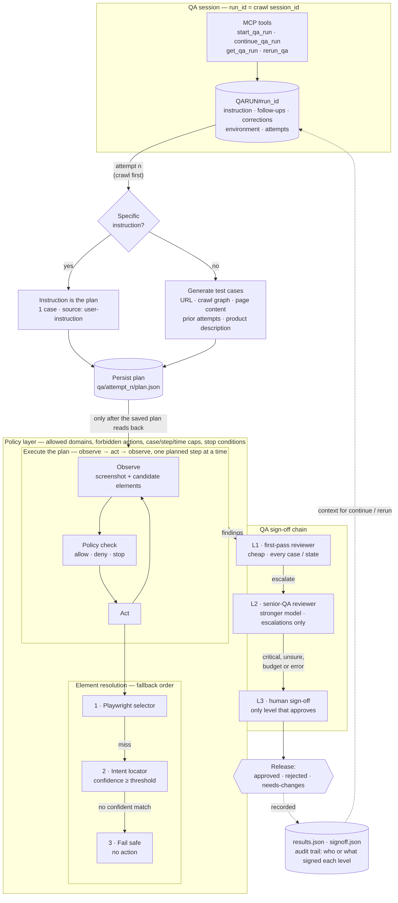

# ScreenWeave — Hybrid Architecture Proposal

**Status:** proposal + first code slices. The intent locator and sign-off chain are building blocks; the QA agent (§4) is wired into the crawl and MCP paths behind `QAAgentEnabled` (default off).
**Anchor:** automate manual QA and run visual QA automatically, at a fraction of the usual cost.

ScreenWeave today replays a fixed crawl and reviews the screenshots. This proposal turns it into a hybrid system that mirrors how a real QA organisation works: testers explore the product and capture issues, senior QA triages them, and a human signs off the release. Cheap automation does the bulk of the work; expensive judgement is spent only where it matters.



Diagram source: [`architecture.mmd`](architecture.mmd) (rendered to PNG because some GitHub clients do not draw mermaid).

---

## 1. Current state

| Part | Where | What it does |
|---|---|---|
| Crawler | `src/crawler/crawl.py` | Playwright on ephemeral EC2. Walks same-origin links to `MAX_DEPTH`, scrolls, clicks a fixed list of CSS selectors (`[role=tab]`, `button:not([disabled])`, `details > summary`, ...), captures a full-page screenshot plus metadata per state, writes `states.json` / `transitions.json` / `trace.zip`. Requests to internal addresses are refused after DNS (`guard_request`). |
| MCP server | `src/lambda/mcpServer/` | `crawl_url`, `get_session_status`, `get_screenshots`, `get_metrics`, `get_full_session`, `export_session`, `generate_apple_video`. |
| Visual QA | `src/lambda/visualQAWorker/` | Tiered review of a completed session: local heuristics → Haiku → Sonnet (`image_classifier.py`), perceptual-hash cache (`cache.py`), multi-turn Bedrock `invoke_model` conversation, one consolidated `qa_report.json`. |

Limits this proposal addresses:

1. **Brittle interaction.** The crawler only knows CSS selectors. A redesign that renames an id or swaps a `<button>` for a styled `<div role=button>` silently drops that state from the crawl.
2. **Replay, not exploration.** The crawl order is fixed (links, scroll, a selector list). It cannot pursue a goal ("add an item and reach checkout"), notice it is stuck, or decide it is done.
3. **No explicit guardrails beyond the network guard.** Depth and link caps exist; there is no notion of forbidden actions, step or cost budgets, or stop conditions.
4. **One-shot report, no sign-off.** Visual QA produces a single report. There is no structured finding, no triage, no record of who accepted what, and no human gate.

## 2. Target layered design

From the bottom up:

| Layer | Responsibility | Cost profile |
|---|---|---|
| **Deterministic layer** (Playwright) | Known flows and selectors, exactly as today. Fast, free, reproducible. Always tried first. | ~0 |
| **Intent locator** | When a selector misses, find the element by what it is for ("the checkout button"). A vision-and-language model sees the screenshot plus a compact candidate list (role, accessible name, text, bounding box) and picks one candidate with a confidence and rationale, or says no match. Re-resolves after a layout shift. | One small-model call per miss |
| **Explore loop** | Treat the browser as an environment: observe → decide → act → observe. Each step produces a state for the artifact graph, so exploration feeds the same `states.json` / `transitions.json` contract. | Bounded by policy budgets |
| **Policy layer** (ScreenWeave) | What to do, what to avoid, when to stop. Goals, allowed domains, forbidden actions, step / cost / time budgets, stop conditions. Checked before every action. | Free (deterministic rules) |
| **QA sign-off chain** | L1 cheap AI reviewer → L2 senior AI reviewer → L3 human. Structured findings, escalation rules, per-tier budgets, audit trail. | Most work stops at L1 |
| **QA agent sessions** (§4) | The conversation around a run: run ID = crawl session id, stored instruction / follow-ups / corrections, plan-first execution, rerun from stored context. | Talking is free; each attempt is one crawler instance |

### 2.1 Interfaces between layers

All Python, standard library dataclasses, matching the crawler's style. Shipped in this PR: the intent locator (§2.2) and the sign-off chain data model (§3). The explore loop and policy interfaces below are the proposed contract for the next phases.

```python
# Intent locator (src/crawler/intent_locator.py) — shipped
Candidate(id, tag, role, name, text, bbox: BBox, attributes)
Observation(url, candidates, screenshot: bytes | None, viewport, title)
class VisionModelClient(Protocol):
    def choose(self, intent, observation, candidates) -> ModelChoice: ...
IntentFinder(model, min_confidence=0.6, max_candidates=40, max_model_calls=None)
    .find(intent, observation) -> Match | NoMatch
await resolve(page, selector, intent, finder, enabled=None) -> Resolution
await resolve_stable(page, selector, intent, finder, ...) -> Resolution

# Explore loop — proposed
Action(kind: "click"|"fill"|"select"|"navigate"|"scroll"|"stop",
       selector: str | None, intent: str | None, value: str | None, reason: str)
class Planner(Protocol):
    def next_action(self, goal, observation, history) -> Action: ...
StepRecord(step, observation_ref, action, resolution, outcome, cost_usd)

# Policy layer — first slice shipped as QAPolicy (src/crawler/qa_agent.py)
QAPolicy(allowed_domains, max_cases, max_steps_per_case, max_total_steps,
         max_seconds, allowed_test_values)
QAPolicy.check_plan(plan) -> notes            # trims to the caps
QAPolicy.check_action(step, url, steps_done, elapsed) -> Decision(allow | deny | stop, reason)
# Proposed generalisation for the explore loop
Policy(goal, ..., forbidden_text_patterns, max_cost_usd, stop_conditions)
```

### 2.2 Fallback order for finding an element

1. **Selector first.** If the selector matches exactly one visible element, use it. No model call.
2. **Intent locator**, only when enabled (`SCREENWEAVE_INTENT_LOCATOR=on`) and an intent is given. The candidate list is pre-ranked and capped (default 40) so a page with hundreds of elements stays cheap. The model's answer is validated: invented ids are rejected, and anything below `min_confidence` (default 0.6, `SCREENWEAVE_INTENT_MIN_CONFIDENCE`) is treated as no match.
3. **Fail safe.** No locator, no action. The step is recorded with every attempt and its reason, and the explore loop or the policy decides what happens next (try another path, stop, or raise a finding).

After resolving, `resolve_stable` waits a short settle time and re-measures the element. If it moved or was detached (late banner, re-render, A/B swap), it resolves again, up to a small limit, so the click lands on what is on screen now.

### 2.3 Safety

Enforced by deterministic code, never delegated to a model:

- **Policy check before every action.** The planner proposes; the policy layer allows, denies or stops. A denied action is recorded and never executed.
- **No credential entry.** `fill` actions into password, one-time-code or payment fields (by input type, autocomplete hint or accessible name) are forbidden by default. Authenticated testing uses a pre-provisioned test session supplied by the operator, never typed by the agent.
- **Domain allowlist.** Navigation and clicks that would leave the allowed domains are denied. This sits on top of the existing `guard_request`, which still refuses internal addresses after DNS.
- **Forbidden actions.** Default denylist for destructive or irreversible intents (delete, purchase, pay, submit order, unsubscribe, send) unless a policy explicitly allows them on a test environment.
- **Budgets.** Hard caps on steps, model calls, estimated cost and wall-clock time per session. Hitting a cap stops the loop cleanly and is reported; it never silently continues.
- **Confidence threshold.** A wrong click is worse than no click: below-threshold intent matches fail safe.
- **Prompt hygiene.** Page text is data, not instructions. Model replies are parsed as strict JSON and validated against the candidate list.

---

## 3. QA sign-off chain (central)

Real QA runs a chain: a tester captures issues, a senior reviewer triages them, a lead signs off. ScreenWeave mirrors that with AI tiers so most of the work is done by the cheapest reviewer and only a short, pre-triaged queue reaches a person.

### 3.1 The chain

| Level | Who | Sees | Does | Runs |
|---|---|---|---|---|
| **L1** first-pass reviewer | Small, cheap vision model (or the existing local heuristic tier for trivial screens) | Every captured state, in batches (default 10 per call, matching the worker's batching) | Captures issues as structured findings: severity, screenshot region, repro steps, evidence, confidence | Every run |
| **L2** senior-QA reviewer | Stronger model | **Only** L1's escalated findings and their evidence, never the full session | Confirms, dismisses or reclassifies each finding; flags what needs a human | Only when L1 escalates |
| **L3** human sign-off | A named person | Only the flagged queue (worst first), plus the L1/L2 sign-offs and audit trail | Approves, rejects or requests changes for the release | Once per release candidate |

Each level runs less often and costs more than the one below it. **Only L3 can approve a release.** The code enforces this: an L3 sign-off from anything other than a human signer raises an error, and the release state stays `pending` until a human signs.

### 3.2 Finding schema

```json
{
  "id": "f_3a9c1e07b2",
  "title": "Checkout button overlaps cookie banner on mobile width",
  "severity": "major",
  "category": "layout",
  "state_id": "state_0007",
  "url": "https://app.example/cart",
  "description": "The primary action is partly covered and not clickable at 390px.",
  "screenshot_key": "screenshots/state_0007.png",
  "region": {"x": 24, "y": 1180, "width": 342, "height": 56},
  "repro_steps": ["Open /cart at 390x844", "Do not dismiss the cookie banner", "Scroll to the bottom"],
  "evidence": [{"kind": "screenshot", "ref": "screenshots/state_0007.png", "note": "region above"},
               {"kind": "dom", "ref": "[data-sw-candidate=c12]", "note": "bbox intersects banner"}],
  "confidence": 0.82,
  "raised_by": "l1-reviewer-id",
  "status": "escalated",
  "original_severity": null,
  "needs_human": false,
  "escalation_reasons": ["severity major >= major"],
  "l2_rationale": ""
}
```

- **Severity:** `critical` (blocks release: broken core flow, data loss, crash) · `major` (feature wrong or unusable, no workaround) · `minor` (wrong, has a workaround) · `cosmetic` (polish).
- **Category:** `visual` · `layout` · `functional` · `content` · `accessibility`.
- **Status:** `open` (L1 only, not escalated) · `escalated` · `confirmed` · `dismissed` · `reclassified` (keeps `original_severity`).

### 3.3 Escalation rules and thresholds

Defaults in `EscalationRules`; they are starting points to tune against labelled runs, not measured values.

**L1 → L2** (any one is enough):

| Rule | Default |
|---|---|
| Severity at or above | `major` |
| L1 confidence below | 0.70 |
| Category always escalates | `functional`, `accessibility` |

Confident `minor` / `cosmetic` findings stay at L1. They are still recorded in the report; they just do not spend L2 budget.

**L2 → human** (any one is enough):

| Rule | Default |
|---|---|
| L2 asks for a human | verdict flag |
| Confirmed severity at or above | `critical` |
| L2 confidence below | 0.60 |
| L2 dismissed or downgraded a `critical` | always (a second opinion on the riskiest call) |
| L2 returned no verdict, errored, or its budget ran out | always |

**Level outcomes:**

| Level | `approved` | `needs-changes` | `rejected` |
|---|---|---|---|
| L1 | No finding met an escalation rule and every state was reviewed | Something escalated, or some states were not reviewed (budget or error) | — |
| L2 | Every escalation dismissed or reduced to minor/cosmetic (or nothing escalated: signed by a rule, no model call) | A confirmed `major`, or an escalation left unresolved | A confirmed `critical` |
| L3 | Human approves the release | Human requests changes | Human rejects |

L1 and L2 outcomes are advice to the human, not a release decision.

### 3.4 Sign-off states

`pending` → one of `approved` · `rejected` · `needs-changes`.

- L3 starts `pending` after every run and only a human signer can move it.
- A human approving over a confirmed `critical`, or over states that were never reviewed, must write a note. The chain refuses a silent approval.
- A new run on a new build starts a new chain; sign-offs never carry over between builds.

### 3.5 Audit trail

Every decision appends an event: timestamp, level, actor kind (`model` · `human` · `rule`), actor id (reviewer/model id, person's name, or rule name), action (`finding`, `confirm`, `dismiss`, `reclassify`, `error`, `skipped`, `ignored`, `signoff:<state>`) and details (finding ids, reasons, confidence). Events are append-only and stored with the run (`ReviewRun.to_dict()`, intended to sit next to `qa_report.json`). Reading the trail answers "who or what signed each level, and why" for any release.

### 3.6 Per-tier budgets and cost model

Each tier has a `TierBudget` (max calls, max estimated USD per run). Budgets fail toward a human, never toward approval:

- L1 out of budget → remaining states are listed as unreviewed; L1 signs `needs-changes`; the human must note why they approve anyway.
- L2 out of budget → remaining escalations go straight to the human queue.

**Cost model — EXAMPLE NUMBERS ONLY.** Every figure below is an illustrative assumption to show the shape of the economics, not a price quote, benchmark or measurement. Real per-call costs depend on the model, region, image size and prompt length; measure them before relying on any of this.

| Assumption (example) | Value |
|---|---|
| States per run | 200 |
| States per L1 call | 10 |
| L1 cost per call (small model, ~10 images) | $0.004 |
| Findings per state | 0.3 |
| Share of findings that escalate to L2 | 20% |
| Findings per L2 call | 20 |
| L2 cost per call (stronger model) | $0.05 |
| Human review time per flagged finding | 2 min |
| Share of escalations that reach the human | 25% |

| Tier | Example volume | Example cost |
|---|---|---|
| L1 | 20 calls | $0.08 |
| L2 | 12 escalated findings → 1 call | $0.05 |
| L3 | ~3 flagged findings → ~6 min of a person | person-time only |
| **AI total per run** | | **≈ $0.13** |

For comparison, the same 200 screens reviewed screen by screen by people (EXAMPLE: 1 min per screen for a tester plus a senior pass over their findings) is hours of person-time. In the chain, the person sees about 3 findings with evidence already attached. `signoff_chain.estimate_run_cost()` reproduces the AI side of this arithmetic from whatever inputs you supply.

Where the existing worker already saves money, the chain reuses it: the local heuristic tier and perceptual-hash cache can act as a "level 0" in front of L1, so unchanged or trivial screens never reach a model.

### 3.7 How the other layers feed the chain

- **Intent locator → evidence and findings.** Every resolution is logged with its attempts (`resolution_log()`): selector miss, intent match with confidence and rationale, or fail safe. A selector that stopped matching between builds is itself a finding candidate ("checkout control changed markup"), and a fail-safe on a goal-critical step becomes a `functional` finding that always escalates. Candidate bounding boxes give findings a precise screenshot `region`.
- **Explore loop → repro steps.** Each step is an action with a reason, so the path to any state is a ready-made list of `repro_steps`. Transitions link the finding's state back to how it was reached.
- **Policy layer → scope and budgets.** The policy decides what was explored (goal, allowed domains), so L1's coverage is known. Denied actions and stop reasons are recorded, so a human can see what was deliberately not tested. The policy's cost budget is shared with the chain's L1/L2 budgets so a run has one spending limit.
- **Visual QA worker → L1/L2 reviewers.** The existing Haiku/Sonnet routing maps naturally onto L1/L2 reviewers behind the `L1Reviewer` / `L2Reviewer` protocols; the current single report becomes the L1 pass plus an L2 triage.

---

## 4. QA agent: sessions, run IDs and plan-first runs

The QA agent is the piece a person talks to: "test checkout with an expired card", "no, skip the newsletter", "run it again on a phone-sized screen". It keeps what was said, plans before it acts, and hands failures to the sign-off chain.

### 4.1 Run IDs reuse the crawl session id

There is no second id scheme. A QA run's `run_id` **is** the crawl `session_id`:

- `start_qa_run(url=...)` starts a crawl exactly like `crawl_url`; that crawl's `session_id` becomes the `run_id`.
- `start_qa_run(session_id=...)` attaches to an existing crawl session; its id becomes the `run_id`.

So `get_session_status(run_id)` keeps working, and every artifact of the run sits under the session's existing S3 prefix.

### 4.2 What the session stores, and where

Existing storage only: the sessions table and the artifacts bucket.

| Record | Written by | Holds |
|---|---|---|
| `SESSION#<run_id>` (sessions table) | MCP server / crawler, unchanged | Crawl status, stats |
| `QARUN#<run_id>` (sessions table) | MCP server (`qaRun.mjs`) | Original instruction, product description, environment (URL, viewport), limits, classification hint, every follow-up / correction / rerun adjustment with timestamps, the list of attempts with their adjustments, a version number for optimistic locking |
| `QARUN#<run_id>#ATTEMPT#<n>` (sessions table) | MCP server (REQUESTED / FAILED to launch), then the crawler (`qa_agent.py`) | Status: `REQUESTED → PLANNING → PLANNED → RUNNING → COMPLETED`, or `NEEDS_INPUT` / `FAILED`; mode, case count, summary, release state |
| `<prefix>/<run_id>/qa/attempt_<nnn>/plan.json` (S3) | crawler | The generated test plan (persisted before anything runs) |
| `.../results.json`, `.../signoff.json`, step screenshots | crawler | Per-case and per-step outcomes, the sign-off record and its audit trail |

The two writers never write the same item: the MCP server owns the run record, the crawler owns attempt records and artifacts. Run-record writes are conditional on the version read (retried once on conflict), so two follow-ups sent at once are both kept. Limits: 50 messages of up to 2,000 characters, 20 attempts per run, one active attempt at a time (an attempt silent for an hour stops blocking). Run records expire after 30 days (TTL).

Locally and in tests the same interfaces have in-memory fakes: `InMemoryQARunStore` (Python) and injected `deps` (Node).

### 4.3 Specific instruction vs unspecified: the branching

```
request ─► classify (rule; optional model only if ambiguous)
            ├─ specific ─────► the instruction IS the plan: one test case, source "user-instruction"
            │                   (translated into steps; unparsable parts → needs-clarification, nothing runs)
            └─ unspecified ──► generate test cases from URL, crawl graph, page content,
                                prior attempts and product description (capped)
                       ▼
              policy.check_plan (case and step caps)  ─►  PERSIST plan  ─►  read back, compare digest
                       ▼                                                     (mismatch → stop, run nothing)
              execute step by step, policy.check_action before every step
                       ▼
              failed cases → findings → L1 → L2 → human (§3)
```

**Which request counts.** The agent looks at the newest specific instruction first: a rerun adjustment's `instruction`, then the user's messages newest to oldest, then the original instruction. Exclusion messages ("skip the newsletter", "don't test login") never become the instruction; they remove matching cases from generated plans. If nothing is specific, the run is unspecified and any ambiguous words ("pricing", "mobile") become focus terms that move matching generated cases to the front.

**Plan-first rule.** When the request is unspecified the agent must generate test cases, save them, and only then act. The code enforces the order: `persist_plan` writes the plan and reads it back; a mismatch raises and no step runs. Tests assert that the plan-saved event comes before the first browser action, and that nothing runs when the store drops the plan. A specific instruction is persisted the same way before it runs.

**No open-ended wandering.** Every plan is a finite list of steps. The policy trims plans to `max_cases` (default 8, max 20), steps per case (12) and `max_steps` in total (default 60, max 200), stops on the step or time budget, and denies navigation off the target's domain, destructive clicks (delete, place order, pay, unsubscribe...), and typing into credential or payment fields unless the operator allow-lists a test value.

### 4.4 The classification rule

Deterministic, shared by Python (`qa_agent.classify_request`, authoritative at planning time) and Node (`qaRun.classifyRequest`, the hint `start_qa_run` and `continue_qa_run` return). The word lists and 14 test cases live in `contracts/qa_request_classification.json`; both test suites check their lists equal the contract and every case classifies the same.

1. Empty request → **unspecified** (`empty`).
2. Lowercase; note any `"double-quoted"`, curly-quoted or `` `backticked` `` phrase; remove URLs and quoted phrases.
3. Split into words; drop generic words (`qa`, `test`, `site`, `app`, `the`, `bugs`, `please`, ...).
4. Nothing left and no quote → **unspecified** (`generic`): "QA this site", "test the whole app for bugs".
5. A quote → **specific** (`quoted`). A leftover action verb (`click`, `checkout`, `log`, `fill`, `submit`, ...) → **specific** (`action-verb`). A test verb (`test`, `check`, `verify`, ...) plus any leftover word → **specific** (`test-verb-object`): "verify the footer links".
6. Otherwise → **unspecified, ambiguous** with the leftover words as focus: "the pricing table looks off on mobile".

An optional model classifier (`RequestClassifier`, Bedrock adapter included) is consulted **only** for step 6 and only trusted at confidence ≥ 0.7. Clear cases never cost a model call.

### 4.5 Test-case generation

`TestCaseGenerator.generate(context, max_cases) -> [TestCase]`, with `TestCase = {id, title, steps[{action, intent, selector, value}], expected, priority P0–P2, source, status, notes}`. Allowed step actions: `navigate`, `click`, `fill`, `assert_text`, `assert_visible`, `assert_url`, `assert_no_error`. Sources: `user-instruction`, `url`, `crawl-graph`, `page-content`, `prior-session`, `product-description`, `model`.

- `HeuristicTestCaseGenerator` (default, deterministic, free): re-tests of the previous attempt's failures (P0, `prior-session`); flows the product description names that the crawl actually saw (P0, `product-description`); page-loads-with-heading per crawled page (P1, `page-content` / `url`); each crawled control responds (P2, `crawl-graph`).
- `BedrockTestCaseGenerator`: the same context summarised as JSON to a small model; output validated (unknown actions dropped, unknown sources become `model`, caps enforced).
- Specific requests go through `InstructionTranslator`: `RuleInstructionTranslator` (deterministic: open/click/fill/verify/expect/test clauses) or `BedrockInstructionTranslator`. A part neither can turn into a step (e.g. "with an expired card" without test data) marks the case `needs-clarification`; the attempt ends `NEEDS_INPUT` with the plan saved and nothing executed, and the user answers with `continue_qa_run`.

In the shipped wiring the crawler uses the deterministic generator and translator. The Bedrock adapters exist and are tested against stubs; enabling them on the crawler needs a Bedrock permission that this change does not add (§4.8).

### 4.6 Continue and rerun use the stored context

- `continue_qa_run(run_id, message, kind?)` appends a follow-up or correction (kind inferred from "no", "actually", "skip", ... when omitted) and returns what it will change. Talking never launches anything.
- `rerun_qa(run_id, adjustments?)` adds attempt *n+1* to the same run. The agent then:
  - **redoes the stored plan exactly** when nothing new was said since that plan and no `instruction` / `replan` is given (`case_ids` limits it to those cases);
  - **re-plans** (classify → plan → persist → run) when messages arrived after the last plan, or with `instruction` / `replan: true`.
  - `viewport`, `max_cases` and `max_steps` override the run's settings for that attempt.
- Every attempt re-crawls first (fresh state graph for planning). The crawl artifacts at the session root show the latest attempt; each attempt's QA artifacts stay under `qa/attempt_<nnn>/`.

### 4.7 MCP tools

Listed and callable only when `QA_AGENT_ENABLED=true`; same JSON-RPC envelope, error style and scope table as the existing tools.

| Tool | Scope | Does |
|---|---|---|
| `start_qa_run(url \| session_id, instruction?, product_description?, viewport?, max_cases?, max_steps?)` | execute | Creates the run (run_id = crawl session id), launches attempt 1, returns `run_id`, the classification hint and what the agent will do next |
| `continue_qa_run(run_id, message, kind?)` | execute | Appends to the session |
| `get_qa_run(run_id)` | read | Instruction, messages, environment, limits, last 10 attempts, and the latest plan, results, findings and sign-off state |
| `rerun_qa(run_id, adjustments?)` | execute | Adds and launches the next attempt |

### 4.8 Infrastructure changes (`infra/main-stack.yaml`)

| Change | Default effect on deploy |
|---|---|
| New parameter `QAAgentEnabled` (`'false'` / `'true'`, default `'false'`) and condition `QAAgentOn` | Parameter added; nothing else |
| `McpServerFunction` env `QA_AGENT_ENABLED: !Ref QAAgentEnabled` | Function configuration updated with `QA_AGENT_ENABLED=false`; tools stay hidden and refused |
| `CrawlerInstanceRole` inline policy `QAAgentRunAccess` under `!If QAAgentOn`: `dynamodb:GetItem` on the sessions table; `s3:GetObject` on `screenweave/*/qa/*` in the artifacts bucket | Not created while the parameter is `false`. No IAM change by default |

No new table, bucket or function. The MCP role already has `GetItem` / `PutItem` on the sessions table and `GetObject` on the artifacts bucket, which is all the tools need. The crawler already has `PutItem` on the table and `PutObject` on the bucket for plans and results.

To turn it on, two more things are needed beyond `QAAgentEnabled=true`:

1. Upload `src/crawler/intent_locator.py`, `src/crawler/qa_agent.py` and `src/lambda/visualQAWorker/signoff_chain.py` to `s3://<CrawlerCodeBucket>/crawler/`, next to `crawl.py`. The deploy workflow uploads only `crawl.py` today. Without them a QA attempt still crawls, then records `FAILED: QA agent modules missing`.
2. For model-backed planning or intent locating on the crawler, `bedrock:InvokeModel` on the chosen model for `CrawlerInstanceRole`. Not included here.

### 4.9 How it feeds the rest

- **Intent locator:** every click, fill or visibility check resolves selector first, then by intent when the locator is enabled; resolution failures become step failures with a screenshot.
- **Policy layer:** `QAPolicy` is the first concrete slice of §2's policy layer: plan caps, per-action allow / deny / stop, budgets.
- **Sign-off chain:** each failed case becomes a finding (P0 → critical, P1 → major, P2 → minor; category `functional`, so it always reaches L2) with the failing step's region, all steps as repro steps and screenshots as evidence. L1 is a deterministic execution reviewer (no model). Until an L2 reviewer is configured its budget is zero, so every escalation lands in the human queue, never approved.
- **Explore loop:** not built yet. Planned runs are the bounded first step toward it: the agent explores only through cases it wrote down first.

## 5. Evaluation plan

All offline first; no live sites in CI.

1. **Locator robustness suite.** Pairs of local HTML fixtures (v1 / v2) where the target's id, class, tag, label or position changes. Metrics: hit rate (selector, intent, fail safe), wrong-click rate (must be ~0; a wrong click is worse than a miss), model calls per resolution. This PR ships the first pair plus a re-render case.
2. **Threshold calibration.** Sweep `min_confidence` on the suite with a real model in a manual, budget-capped run; pick the threshold that keeps wrong clicks at zero.
3. **Sign-off chain replay.** Seed sessions with known, labelled defects (layout overlap, broken button, missing text, low contrast) and clean screens. Metrics: L1 recall, L2 precision after triage, share of runs that need a human, human-queue length, AI cost per run vs the example model above.
4. **Explore loop goals.** Small local apps with goals ("reach the confirmation page"). Metrics: goal completion, steps used vs budget, policy denials, zero forbidden actions executed.
5. **Regression gate.** Any change to prompts, thresholds or models replays 1–3 on a saved set and must not regress wrong-click rate or critical-finding recall.

## 6. Phased roadmap

| Phase | Scope | Exit criteria |
|---|---|---|
| **0 (this PR)** | Proposal; intent locator module with Bedrock adapter and fake; sign-off chain data model and L1→L2→human escalation; QA agent sessions (run ID = crawl session id), specific-vs-planned branching with plan-first execution, `QAPolicy`, four MCP tools; crawler hook. All behind `QAAgentEnabled` (default off). | Tests pass offline; with the flag off, `crawl_url`'s boot script, the tool list and IAM are unchanged. |
| **1 — Sign-off chain in Visual QA** | Upload the QA modules with `crawl.py` in the deploy workflow; an L2 reviewer for QA findings; a human sign-off call; L1/L2 visual reviewers on Bedrock behind the protocols (reuse worker batching, routing, cache). Write the sign-off record and audit trail next to `qa_report.json`. Read-only MCP tool to fetch a run's sign-off state; human sign-off recorded by a named person through an explicit call. Feature flag, default off. | Replay suite (§5.3) meets targets; cost per run measured and documented. |
| **2 — Intent locator in the crawler** | Behind `SCREENWEAVE_INTENT_LOCATOR`, `click_interactive` resolves through `resolve_stable` with intents derived from labels; resolution logs added to `states.json`. | Locator suite: zero wrong clicks; measurable recovery on v2 fixtures. |
| **3 — Policy layer** | `Policy` object and `check()` before every action, defaults for domain allowlist, credential-field ban, destructive-intent denylist, step/cost/time caps; policy passed through `crawl_url`. | Every action in a run has a recorded policy decision; budget stops are clean. |
| **4 — Explore loop** | Planner protocol, observe/decide/act loop driven by goals within the policy; steps become states and repro steps. | Goal suite (§5.4) completion with zero forbidden actions. |
| **5 — Hardening** | Cost dashboards per tier, threshold tuning, more fixture pairs, flaky-site handling, human review UI. | Documented costs from real runs replace the example model. |

## 7. Open questions

- Where the human sign-off is recorded (MCP tool, a REST endpoint, or a pull-request check) and how the reviewer identity is verified.
- Whether L1 should see full-page screenshots or viewport crops around candidate regions (cost vs recall).
- How long sign-off records and audit trails are retained (today's session TTL may be too short for release records).
